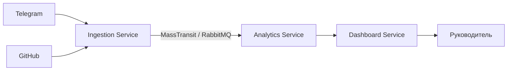

# AI-Агент для анализа активности команды

## О проекте

Система представляет собой набор микросервисов, которые подключаются к рабочим чатам (Telegram) и Git-репозиториям (GitHub).
Агент анализирует сообщения, коммиты и пул-реквесты, автоматически выявляет блокеры и зависшие задачи,
а затем формирует для руководителя ежедневные сводки (дайджесты) по прогрессу команды и рискам.

> **Текущий статус:** это инфраструктурный каркас. Реальные Telegram/GitHub-коннекторы, хранение состояния,
> AI-анализ, расписание дайджестов и SignalR ещё не реализованы. Сейчас проверяется только сквозная передача
> события через RabbitMQ: Ingestion → Analytics.

## Архитектура

Проект состоит из трёх микросервисов на .NET 10 и использует RabbitMQ (через MassTransit) для асинхронного обмена сообщениями:

1. **Ingestion Service** — сбор и нормализация данных (Telegram, GitHub).
2. **Analytics Service** — анализ задач, выявление блокеров и вычисление рисков.
3. **Dashboard Service** — предоставление дайджестов и real-time уведомлений (SignalR).

Целевая схема:



## Структура репозитория

```text
TeamMemory/
  TeamMemory.sln
  global.json
  docker-compose.yml
  README.md
  .gitignore

  src/
    IngestionService/
      Program.cs
      Contracts/PublishTelegramMessageRequest.cs
      appsettings.json
      Properties/launchSettings.json
    AnalyticsService/
      Program.cs
      Consumers/TelegramMessageCreatedConsumer.cs
      Consumers/GitPushCommittedConsumer.cs
      appsettings.json
      Properties/launchSettings.json
    DashboardService/
      Program.cs
      appsettings.json
      Properties/launchSettings.json

  shared/
    Shared.Contracts/
      IntegrationEventBase.cs
      IntegrationEventSources.cs
      Telegram/
      Git/
```

## Требования

- .NET SDK **10.0.x** (проект зафиксирован через `global.json`);
- Docker и Docker Compose — для локального RabbitMQ;
- свободные порты `5081`, `5082`, `5672`, `15672`.

## Запуск RabbitMQ

```bash
docker compose up -d rabbitmq
docker compose ps
```

RabbitMQ Management UI: <http://localhost:15672>

Логин/пароль для локальной разработки:

```text
teammemory / teammemory
```

Это только dev-учётная запись, заданная в `docker-compose.yml` и `appsettings.json`.
Для реальных окружений используйте переменные окружения или секреты, а не файлы в git.

Если используется уже установленный локальный RabbitMQ, настройки можно переопределить:

```powershell
$env:RabbitMq__Host = "localhost"
$env:RabbitMq__Username = "guest"
$env:RabbitMq__Password = "guest"
```

## Сборка

Из корня репозитория:

```bash
dotnet build TeamMemory.sln
```

## Запуск сервисов

Откройте три терминала.

**1. Analytics Service** — запускать первым, чтобы очереди были созданы до публикации:

```bash
dotnet run --project src/AnalyticsService/AnalyticsService.csproj
```

**2. Ingestion Service**:

```bash
dotnet run --project src/IngestionService/IngestionService.csproj
```

Ingestion слушает `http://localhost:5081`.

**3. Dashboard Service** (опционально):

```bash
dotnet run --project src/DashboardService/DashboardService.csproj
```

Dashboard слушает `http://localhost:5082`.

## Smoke-тест

Для проверки сквозной передачи события отправьте тестовое сообщение в dev-endpoint Ingestion Service:

```bash
curl -X POST http://localhost:5081/api/dev/telegram/messages \
  -H "Content-Type: application/json" \
  -d "{\"chatId\":-1001234567890,\"messageId\":1,\"senderUsername\":\"alice\",\"text\":\"blocked on payments API\",\"replyToMessageId\":null}"
```

В Windows PowerShell используйте `curl.exe`:

```powershell
curl.exe -X POST http://localhost:5081/api/dev/telegram/messages `
  -H "Content-Type: application/json" `
  -d '{"chatId":-1001234567890,"messageId":1,"senderUsername":"alice","text":"blocked on payments API","replyToMessageId":null}'
```

Ожидаемый результат:

- Ingestion возвращает `202 Accepted` и `eventId`;
- в логе Analytics Service появляется строка `Получено сообщение из Telegram...`;
- в RabbitMQ Management UI появляются exchange и очередь.

> Важно: endpoint `/api/dev/telegram/messages` доступен только в окружении `Development`.
> Если опубликовать сообщение до запуска Analytics, exchange может не иметь привязанной очереди, и сообщение будет потеряно.

## События и маршрутизация (RabbitMQ)

MassTransit создаёт для каждого типа сообщения exchange и автоматически связывает его с очередями консьюмеров.
Для контракта `Shared.Contracts.Telegram.TelegramMessageCreated` имя exchange в RabbitMQ выглядит так:

```text
Shared.Contracts.Telegram:TelegramMessageCreated
```

Namespace и имя типа разделяются двоеточием. Exchange по умолчанию имеет тип **fanout**.
Публикация идёт в exchange, а маршрутизация до очередей выполняется через bindings.
**Routing key не равен полному имени C#-класса** и для стандартного publish не используется.

Все изменения в контрактах (событиях) делаются **только** в проекте `shared/Shared.Contracts`.

| C# Тип | Источник (Source) | Описание |
| :--- | :--- | :--- |
| `TelegramMessageCreated` | telegram | Новое сообщение в чате |
| `TelegramMessageEdited` | telegram | Изменение сообщения |
| `GitPushCommitted` | github | Пуш с коммитами |
| `GitPullRequestOpened` | github | Создан Pull Request |
| `GitPullRequestMerged` | github | Pull Request смержен |
| `GitPullRequestClosed` | github | Pull Request закрыт без мержа |
| `GitPullRequestReviewed` | github | Общее ревью PR (Approve / Request Changes) |
| `GitPullRequestReviewCommentAdded` | github | Комментарий к конкретной строке в PR |

Сейчас в Analytics Service реализованы консьюмеры только для `TelegramMessageCreated` и `GitPushCommitted`.
Для остальных событий контракты уже готовы, но консьюмеры и очереди появятся позже.

## Правила изменения контрактов

- Контракты живут только в `Shared.Contracts`; копировать их в сервисы нельзя.
- `Shared.Contracts` не должен зависеть от MassTransit — это чистые DTO.
- Нельзя переименовывать или переносить тип/namespace без версионирования: MassTransit использует имя типа в топологии RabbitMQ.
- Новые поля в уже опубликованные события добавляются как nullable/optional.
- Ломающие изменения оформляются через новую версию namespace (`...V1`, `...V2`) с периодом параллельной публикации.
- В monorepo сервисы собираются вместе, но при независимом деплое контракты нужно версионировать как отдельный пакет.

## Ограничения текущего этапа

- Нет реальных Telegram Bot API и GitHub webhooks.
- Нет базы данных и хранения состояния — Analytics пока только логирует события.
- Нет AI/LLM-анализа, расчёта блокеров и ежедневных дайджестов.
- Нет SignalR-хаба и real-time уведомлений.
- Нет аутентификации webhook-ов и HMAC-проверки GitHub.
- Нет retry-политик, outbox, идемпотентности и обработки dead-letter очередей.
- Нет автотестов и CI.

Эти пункты — следующий этап развития, а не готовый функционал текущего каркаса.

## Лицензии

- .NET — MIT.
- RabbitMQ — MPL 2.0.
- MassTransit **8.5.12** — Apache-2.0. Версия зафиксирована в проектах.
- MassTransit **9.x** — коммерческий продукт, требующий лицензии. Не обновляйте пакет до 9.x без согласования лицензии.
