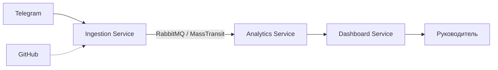

# AI-Агент для анализа активности команды

> **Кратко:** TeamMemory собирает события рабочих чатов через RabbitMQ, анализирует их локальной LLM, сохраняет задачи в PostgreSQL и передаёт Dashboard события новых задач, блокеров и риска. Сейчас реализован основной Telegram-сценарий.

## О проекте

Проект состоит из трёх .NET-микросервисов: Ingestion принимает события, Analytics обрабатывает их, Dashboard сохраняет результаты и формирует дайджесты для Mini App.
Analytics сохраняет Telegram-события в PostgreSQL, анализирует группы сообщений локальной
GGUF-моделью через LLamaSharp и публикует события задач, блокеров и риска для Dashboard.
Запуск описан в [документации Analytics](src/AnalyticsService/README.md).
GitHub-коннекторы — в планах. Дайджесты и обновления Mini App через SignalR реализованы в Dashboard.

## Архитектура



- **Ingestion** — Telegram webhook, публикация `TelegramMessageCreated`.
- **Analytics** — Telegram inbox, групповой LLM-анализ, задачи и история в PostgreSQL, outbox.
- **Dashboard** — хранение событий Analytics в PostgreSQL, дайджест по шаблону, API с проверкой доступа и обновление Mini App через SignalR. [Запуск и контракт](src/DashboardService/README.md).

## Структура

```text
src/IngestionService/     # webhook Telegram, публикация событий
src/AnalyticsService/     # консьюмеры RabbitMQ
src/DashboardService/     # каркас
shared/Shared.Contracts/  # контракты событий
.env.example              # шаблон локальных переменных
docker-compose.yml        # RabbitMQ и PostgreSQL
```

## Требования

- .NET SDK 10.0.x
- Docker и Docker Compose
- ngrok
- Telegram-бот от @BotFather, добавленный в группу
- свободные порты `5081`, `5082`, `5672`, `15672` (`4040` — инспектор ngrok)

## Переменные окружения

`.env` лежит в корне и не коммитится. Шаблон — `.env.example`:

```powershell
Copy-Item .env.example .env
```

| Переменная | Назначение |
| --- | --- |
| `TELEGRAM_BOT_TOKEN` | Токен бота от @BotFather |
| `WEBHOOK_BASE_URL` | Личный ngrok-адрес, например `https://your-name.ngrok-free.dev` |

`WEBHOOK_BASE_URL` указывается без завершающего `/`. Переменные ОС имеют приоритет над `.env`.

## Telegram и ngrok

1. Создайте бота в @BotFather и добавьте токен в `.env`.
2. Добавьте бота в группу и отключите privacy mode (`/setprivacy` → `Disable`) или сделайте его администратором.
3. Один раз авторизуйте ngrok:

```powershell
ngrok config add-authtoken <TOKEN>
```

4. Запустите туннель:

```powershell
ngrok http 5081
```

5. Скопируйте адрес из лога в `.env`:

```text
WEBHOOK_BASE_URL=https://your-name.ngrok-free.dev
```

Домен постоянный и у каждого разработчика свой. Инспектор запросов — <http://127.0.0.1:4040>, работает только при запущенном ngrok.

## Запуск RabbitMQ

```bash
docker compose up -d rabbitmq postgres
```

UI: <http://localhost:15672>, логин/пароль `teammemory` / `teammemory`.

## Сборка

```bash
dotnet build TeamMemory.sln
```

## Запуск сервисов

**Терминал 1 — Analytics** (запускать первым, чтобы очереди существовали до публикации):

```bash
dotnet run --project src/AnalyticsService/AnalyticsService.csproj
```

**Терминал 2 — Ingestion**:

```bash
dotnet run --project src/IngestionService/IngestionService.csproj
```

Ingestion слушает `http://localhost:5081` и в Development сам вызывает `SetWebhook`. Ожидаемый лог:

```text
Telegram webhook set: https://your-name.ngrok-free.dev/api/telegram/webhook
```

**Dashboard** (опционально, порт `5082`):

```bash
dotnet run --project src/DashboardService/DashboardService.csproj
```

## Проверка

```powershell
$token = ((Get-Content .env | Where-Object { $_ -match '^\s*TELEGRAM_BOT_TOKEN\s*=' }) -split '=',2)[1].Trim()
Invoke-RestMethod "https://api.telegram.org/bot$token/getWebhookInfo" |
    Select-Object -ExpandProperty result |
    Format-List url, pending_update_count, last_error_message
```

Должно быть: `url` — твой ngrok-адрес, `pending_update_count: 0`, `last_error_message` пустой.

Отправьте сообщение в группу. В логах:

```text
[Ingestion] Received Telegram webhook. ChatId: ..., MessageId: .... Publishing event with EventId: <GUID>
[Analytics] Successfully received event from RabbitMQ! EventId: <GUID>, ChatId: ..., Sender: ...
```

`EventId` должен совпадать.

> Без Telegram можно использовать `POST /api/dev/telegram/messages` (только Development).

## События и RabbitMQ

MassTransit создаёт exchange `Shared.Contracts.Telegram:TelegramMessageCreated` (fanout) и очередь консьюмера.
Публикация идёт в exchange, routing key не используется.

Контракты меняются только в `shared/Shared.Contracts`. Переименование типа или namespace ломает топологию RabbitMQ.
Новые поля добавляются как nullable, ломающие изменения — через новую версию namespace.

Analytics подписан на все восемь конкретных событий из `Shared.Contracts`; подробности и ограничения описаны в [документации Analytics](src/AnalyticsService/README.md).

## Ограничения

- GitHub webhooks не реализованы.
- Для AI-анализа нужно отдельно скачать GGUF-модель и настроить привязку чата к команде. Дайджест показывает новые события за день; завершение задач и снятие блокеров пока не передаются в Dashboard.
- Нет `secret_token` для Telegram webhook и HMAC для GitHub.
- Inbox/outbox Analytics хранятся в PostgreSQL. Редактирования Telegram и Git пока только логируются; CI отсутствует.

## Лицензии

- .NET — MIT.
- RabbitMQ — MPL 2.0.
- MassTransit **8.5.12** — Apache-2.0. Версия 9.x коммерческая, не обновлять без согласования.
