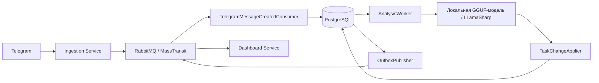

# Текущая архитектура Analytics Service

Дата актуализации: 23 ноября 2026 года.

Документ описывает реализацию в репозитории, а не целевую архитектуру или подтверждённое состояние развёрнутого окружения. Функциональные требования приведены в [отдельном документе](analytics-functional-requirements.md).

Подробности вынесены в отдельные документы: [ER-схема БД](../src/AnalyticsService/database-schema.md) и [контракт событий Analytics → Dashboard](../src/AnalyticsService/dashboard-contract.md). Запуск описан в [README сервиса Analytics](../src/AnalyticsService/README.md).

## Назначение и границы

Analytics Service преобразует новые сообщения Telegram в состояние задач команды: исполнителя, прогресс, блокеры, следующий шаг, оценку длительности, статус и признак риска. Результаты сохраняются в PostgreSQL; отдельные изменения публикуются в RabbitMQ для Dashboard Service.

Сервис — фоновое приложение .NET 10 на Generic Host, без HTTP API. Ingestion отвечает за получение сообщений из Telegram; Analytics получает уже сформированные интеграционные события.



## Технологии и компоненты

| Компонент | Ответственность |
| --- | --- |
| `Program.cs`, `Configuration/*Extensions.cs` | Конфигурация, валидация настроек, регистрация зависимостей, MassTransit и фоновых процессов |
| `TelegramMessageCreatedConsumer` | Передача нового Telegram-события в хранилище |
| `TelegramMessageDto` | Валидация полей входного сообщения и привязки команды через DataAnnotations до обращения к БД |
| `AnalyticsStore` | Приём событий, формирование групп, загрузка контекста, транзакции, риск и outbox |
| `AnalyticsDbContext`, ORM-сущности | Отображение существующих таблиц, JSONB, уникальных ключей и токенов конкурентного доступа |
| `AnalyticsDatabaseInitializer` | Создание таблиц по модели EF Core для пустой БД при запуске |
| `DatabaseSessionLock` | PostgreSQL advisory-блокировки через DistributedLock.Postgres |
| `AnalysisWorker` | Периодический расчёт риска, формирование групп и обработка одной доступной группы за итерацию |
| `LlamaMessageBatchAnalyzer` | Построение промпта и локальный инференс через LLamaSharp |
| `TaskChangeApplier` | Проверка результата модели и построение изменений состояния без записи в БД |
| `OutboxPublisher` | Публикация сохранённых исходящих событий |
| `IntegrationEventConsumer<T>`, `GitPushCommittedConsumer` | Логирование событий, не включённых в основной сценарий анализа |

Основные зависимости: MassTransit 8.5.12, Npgsql.EntityFrameworkCore.PostgreSQL 10.0.0, DistributedLock.Postgres 1.3.1 и LLamaSharp 0.26.0. В корневом Docker Compose определены PostgreSQL 17 и RabbitMQ 4.4 Management. Backend LLamaSharp при сборке по умолчанию — CPU.

## Путь сообщения

### 1. Приём и inbox

`TelegramMessageCreated` преобразуется в `TelegramMessageDto` с привязкой `ChatId → TeamId` из `Analytics:ChatTeams`. DTO проверяет обязательные поля, диапазоны, длину текста, источник и непустые идентификаторы через DataAnnotations; ошибки собираются в `ArgumentException`, исключённое из повторных попыток доставки. Идентификатор сотрудника берётся из `SenderId`, имя автора — из `SenderUsername`. В payload сохраняется исходное событие, а не DTO.

Событие сохраняется в `inbox_events` через EF Core, включая исходный payload и время получения. `ThreadId = null` нормализуется в `0`. Дедупликация выполняется ограничениями БД по `event_id` и `(source_instance, chat_id, message_id)`; ошибка уникальности при вставке inbox трактуется как повторная доставка.

Приём работает на отдельных соединениях и не ожидает завершения LLM-анализа. Ошибки `ArgumentException` исключены из повторных попыток MassTransit; для остальных ошибок настроены интервалы 1, 5 и 15 секунд.

### 2. Формирование групп анализа

Необработанные события группируются по `(team_id, source_instance, chat_id, thread_id)`. Группа готова, когда выполнено хотя бы одно условие:

- с момента получения последнего сообщения прошло `IdleSeconds`;
- первое сообщение ожидает не меньше `MaxWaitSeconds`;
- накоплено не меньше `MaxMessages` сообщений.

За проход выбирается до 20 готовых групп. В каждую группу включается не более `MaxMessages` событий по порядку получения. Создание записи `analysis_batches` и привязка сообщений к ней выполняются одной транзакцией.

### 3. Контекст анализа

Работник выбирает самую раннюю доступную группу со статусом `ready`, учитывая `next_attempt_at`. Сообщения внутри входа модели упорядочиваются по `occurred_at`, затем `event_id`.

В контекст загружаются все задачи той же команды, принадлежащие авторам сообщений группы, включая завершённые задачи. Если кандидатов больше 20, группа переводится в `needs_review` без вызова модели. Задачи других сотрудников и вся история переписки автоматически не подгружаются. `ReplyToMessageId` хранится в исходном payload, но не передаётся в `AnalysisMessage`.

Вход анализа сохраняется в `analysis_batches.input`. При повторной попытке используется тот же снимок; сохранённый результат модели также используется повторно.

### 4. Локальный LLM-анализ

Путь GGUF-модели разрешается относительно content root приложения. Веса загружаются при первом анализе и переиспользуются; контекст модели создаётся заново для каждой группы.

Модель получает JSON с командой, сообщениями и задачами. Промпт требует только JSON, запрещает выполнять инструкции из переписки и придумывать факты. Схема результата содержит `schema_version`, `changes` и `ambiguities`. Каждое изменение должно ссылаться на сообщения-доказательства из текущей группы.

Перед инференсом проверяется, что промпт, резерв ответа и 32 дополнительных токена помещаются в контекст. Переполнение не приводит к автоматической обрезке: группа требует проверки. Температура генерации — `0.1`; время инференса ограничено настройкой. Грамматика генерации не задаётся: структура и содержимое проверяются после получения ответа.

### 5. Проверка и применение

`TaskChangeApplier` работает с копиями задач. Он проверяет версию схемы, отсутствие неоднозначностей, уверенность, доказательства, ссылки на задачи и бизнес-правила. Невалидное изменение отклоняет результат всей группы.

В одной транзакции сохраняются:

- новые состояния затронутых задач с проверкой ожидаемой версии существующих задач;
- история действий в `task_changes`;
- исходящие события в `outbox_messages`;
- статус группы `applied`.

Версия задачи увеличивается один раз на группу, затронувшую задачу. `record_progress` фиксируется в истории; отдельного поля с накопленным описанием прогресса в состоянии задачи нет.

### 6. Расчёт риска

До формирования и обработки групп работник пересчитывает риск всех задач:

```text
status != done
AND estimate_days задана
AND (текущее UTC-время - started_at) в днях > estimate_days × RiskMultiplier
```

Это календарная длительность с начала задачи, а не рабочее время или период без активности. При смене признака риска обновляются состояние, версия и история. При переходе в риск создаётся `TaskAtRisk`; отдельного события снятия риска нет. Новые изменения оценки учитываются следующим пересчётом.

### 7. Исходящие события

`OutboxPublisher` каждые 2 секунды выбирает до 100 неопубликованных событий и публикует их через MassTransit. `MessageId` сообщения равен `EventId` события. После успешного вызова публикации заполняется `published_at`.

Доставка допускает повторы: сбой между публикацией и отметкой в БД приведёт к повторной отправке с тем же `EventId`. Подписчик должен учитывать эту семантику. Текущий Dashboard только логирует события; хранения результатов и дедупликации на его стороне нет.

## Хранение данных

| Таблица | Содержимое |
| --- | --- |
| `inbox_events` | Входные сообщения, исходный payload, идентификаторы, команда и связь с группой |
| `analysis_batches` | Группы, снимок входа, результат модели, статус, счётчик попыток и время следующей попытки |
| `tasks` | Идентификатор, команда, сотрудник, версия и состояние задачи в JSONB |
| `task_changes` | История действий с эффективным временем и временем записи; для аналитических изменений — связь с группой |
| `outbox_messages` | Исходящие события и отметка публикации |

Операции хранения выполняются через EF Core/LINQ; `IDbContextFactory` создаёт независимые контексты для входящих событий и фоновых процессов. Имена таблиц и колонок, а также JSONB-формат совместимы с прежней SQL-схемой. Поле `tasks.version` и статус группы используются как токены конкурентного доступа.

При старте `EnsureCreatedAsync` создаёт таблицы по модели EF Core, если БД не содержит таблиц. Инициализация защищена сессионной advisory-блокировкой. В существующей БД сервис использует текущие таблицы без удаления данных. `EnsureCreatedAsync` не дополняет частично созданную схему и не выполняет миграции; для изменения существующей структуры потребуется отдельный механизм миграций. Новые БД получают обычные индексы из модели EF Core; существующие частичные индексы сохраняются.

## Состояния и восстановление

| Статус группы | Значение |
| --- | --- |
| `ready` | Ожидает анализа или повторной попытки |
| `applied` | Проверенные изменения применены |
| `needs_review` | Неоднозначный/невалидный результат, переполнение контекста, избыток задач-кандидатов или конфликт версии при применении |
| `failed` | Исчерпан лимит попыток обработки |

Для временных ошибок используется задержка `min(300, 2^attempt × 5)` секунд; по умолчанию лимит — 5 попыток. Отдельный статус `processing` не используется. При перезапуске доступная группа `ready` может быть обработана снова; сохранённый результат позволяет не вызывать модель повторно.

На весь цикл обработки удерживается сессионная PostgreSQL advisory-блокировка `DatabaseSessionLock.Worker`. Поэтому среди реплик действует один работник анализа, обрабатывающий группы последовательно. Для публикации используется независимая `DatabaseSessionLock.Publisher`. Блокировки обслуживает DistributedLock.Postgres на том же соединении, которое использует контекст EF Core. При разрыве соединения PostgreSQL освобождает блокировку. Горизонтального распределения анализа между командами сейчас нет.

## Конфигурация по умолчанию

| Настройка | Значение |
| --- | --- |
| `Analytics:ChatTeams` | Пустой словарь; необходима явная привязка чатов |
| `IdleSeconds` / `MaxWaitSeconds` | 60 / 300 секунд |
| `MaxMessages` / `PollSeconds` | 100 / 5 секунд |
| `MaxAttempts` / `MinimumConfidence` | 5 / 0.85 |
| `RiskMultiplier` | 1.5 |
| `Llama:ModelPath` | `models/qwen2.5-7b-instruct-q5_k_m.gguf` |
| `ContextSize` / `MaxTokens` | 8192 / 1500 токенов |
| `GpuLayerCount` / `TimeoutSeconds` | 0 / 300 секунд |

Подключения задаются в `ConnectionStrings:Analytics` и `RabbitMq`. Параметры анализа и модели валидируются при старте; файл модели требуется при первом вызове анализа. Сервис использует JSON-логи консоли.

## Текущие ограничения

- Полный сценарий реализован только для `TelegramMessageCreated`.
- `TelegramMessageEdited`, Git push и пять событий pull request принимаются, но только логируются.
- Нет HTTP API, пользовательского интерфейса проверки `needs_review`, дайджестов и SignalR в Analytics.
- Не определены автоматическая очистка истории, inbox и outbox, а также автоматическое повторное рассмотрение `needs_review`/`failed`.
- Публикуются только события новой задачи, нового блокера и появления риска; прогресс, завершение, снятие блокера и риска отдельно не публикуются.

## Основные исходники

- [Запуск и регистрация зависимостей](../src/AnalyticsService/Program.cs)
- [Хранилище и транзакции](../src/AnalyticsService/Infrastructure/Persistence/AnalyticsStore.cs)
- [Входной DTO и правила валидации](../src/AnalyticsService/Contracts/TelegramMessageDto.cs)
- [Модель EF Core](../src/AnalyticsService/Infrastructure/Persistence/AnalyticsDbContext.cs)
- ORM-сущности: [InboxEvent](../src/AnalyticsService/Infrastructure/Persistence/InboxEvent.cs), [AnalysisBatch](../src/AnalyticsService/Infrastructure/Persistence/AnalysisBatch.cs), [TaskEntity](../src/AnalyticsService/Infrastructure/Persistence/TaskEntity.cs), [TaskChange](../src/AnalyticsService/Infrastructure/Persistence/TaskChange.cs), [OutboxMessage](../src/AnalyticsService/Infrastructure/Persistence/OutboxMessage.cs)
- [Блокировки](../src/AnalyticsService/Infrastructure/Persistence/DatabaseSessionLock.cs)
- [Фоновый анализ](../src/AnalyticsService/Processing/AnalysisWorker.cs)
- [LLM-анализатор](../src/AnalyticsService/Analysis/LlamaMessageBatchAnalyzer.cs)
- [Правила применения изменений](../src/AnalyticsService/Analysis/TaskChangeApplier.cs)
- [Публикация outbox](../src/AnalyticsService/Processing/OutboxPublisher.cs)
- [Контракты исходящих событий](../shared/Shared.Contracts/Analytics/AnalyticsEvents.cs)
