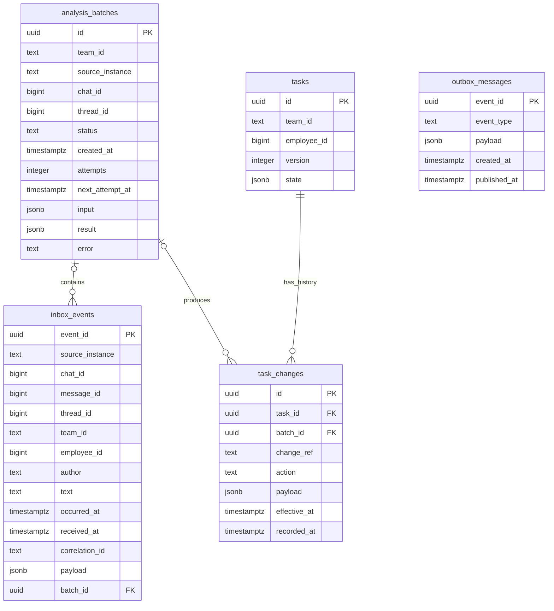

# Схема базы данных Analytics Service

Актуально на 23 ноября 2026 года. Описание основано на текущем коде репозитория.

[Вернуться к README сервиса](README.md).

Схема развёрнутой БД отдельно не проверялась.

Хранилище — PostgreSQL; доступ — Entity Framework Core. Источник схемы: [AnalyticsDbContext](Infrastructure/Persistence/AnalyticsDbContext.cs). Названия таблиц и колонок преобразованы в `snake_case`.

## ER-диаграмма



`PK` — первичный ключ, `FK` — внешний ключ. Все поля обязательны, кроме перечисленных ниже:

| Таблица | Nullable-поля | Значение `NULL` |
| --- | --- | --- |
| `inbox_events` | `batch_id` | Сообщение ещё не назначено группе |
| `analysis_batches` | `input`, `result`, `error` | Вход/результат ещё не сохранён; ошибка отсутствует |
| `task_changes` | `batch_id` | Изменение создано пересчётом риска вне группы анализа |
| `outbox_messages` | `published_at` | Событие ещё не отмечено как опубликованное |

На диаграмме показаны физические FK. `team_id` и `employee_id` — внешние идентификаторы без FK на локальные таблицы команд/сотрудников. `outbox_messages` не имеет FK: связь с задачей и доказательствами хранится внутри JSON события. `evidence_event_ids` также не является SQL-связью.

## Назначение таблиц

| Таблица | Что хранит |
| --- | --- |
| `inbox_events` | Новые Telegram-сообщения, исходный payload, автора, команду, чат, тред и время получения |
| `analysis_batches` | Группы сообщений, зафиксированный вход LLM, её ответ, число попыток и состояние обработки |
| `tasks` | Текущее состояние задачи в JSONB и поля для поиска по команде/сотруднику и проверки версии |
| `task_changes` | Историю изменений с эффективным временем и временем записи |
| `outbox_messages` | Аналитические события, подлежащие отправке в RabbitMQ, и отметку публикации |

Статусы группы: `ready`, `applied`, `needs_review`, `failed`. Это правила приложения; отдельного PostgreSQL enum или CHECK для статусов модель не задаёт.

Время события `occurred_at` отличается от времени приёма `received_at`. `task_changes.effective_at` для LLM-изменений — максимальное время сообщения-доказательства, `recorded_at` — время записи истории.

## Содержимое `tasks.state`

Состояние сериализуется из [TrackedTask](Analysis/AnalysisModels.cs) в `snake_case`:

```json
{
  "id": "11111111-1111-4111-8111-111111111111",
  "team_id": "team-backend",
  "employee_id": 123456789,
  "title": "Интеграция оплаты",
  "status": "blocked",
  "next_step": "Получить доступ к API",
  "estimate_days": 2,
  "started_at": "2026-11-20T09:00:00+00:00",
  "last_activity_at": "2026-11-23T09:00:00+00:00",
  "at_risk": false,
  "version": 3,
  "blockers": ["Нет доступа к API"]
}
```

`next_step` и `estimate_days` могут быть `null`. Статусы задачи: `in_progress`, `blocked`, `done`. Оценка задаётся в календарных днях. Плоские колонки `id`, `team_id`, `employee_id`, `version` дублируют соответствующие значения JSON и синхронно записываются сервисом.

Другие JSONB-поля:

- `inbox_events.payload` — исходный `TelegramMessageCreated` с исходными именами C#-полей, например `EventId` и `ChatId`;
- `analysis_batches.input` — `AnalysisInput`: `batch_id`, `team_id`, `messages`, `tasks`;
- `analysis_batches.result` — `AnalysisResult`: `schema_version`, `changes`, `ambiguities`;
- `task_changes.payload` — `AnalysisChange`, а для `set_risk` — объект `{ "at_risk": true/false }`;
- `outbox_messages.payload` — сериализованное аналитическое событие с исходными именами C#-полей, например `EventId` и `TaskId`.

## Ограничения и индексы

| Объект | Правило |
| --- | --- |
| `inbox_events.event_id` | PK; защита от повторной доставки события |
| `inbox_events(source_instance, chat_id, message_id)` | UNIQUE; защита от повторного приёма одного Telegram-сообщения с новым `EventId` |
| `task_changes(batch_id, change_ref)` | UNIQUE; уникальность изменения внутри группы. Для `batch_id = NULL` это ограничение не дедуплицирует пересчёты риска |
| `ix_inbox_pending` | Индекс по `inbox_events.received_at` |
| `ix_inbox_batch` | Индекс по `inbox_events.batch_id` |
| `ix_batches_ready` | Индекс по `analysis_batches.next_attempt_at` |
| `ix_tasks_team_employee` | Индекс по `tasks(team_id, employee_id)` |
| `ix_outbox_pending` | Индекс по `outbox_messages.created_at` |

FK `inbox_events.batch_id → analysis_batches.id`, `task_changes.batch_id → analysis_batches.id`, `task_changes.task_id → tasks.id` используют `DeleteBehavior.NoAction`: каскадного удаления нет. EF Core также создаёт индекс для FK `task_changes.task_id` по соглашению.

`tasks.version` и `analysis_batches.status` — токены конкурентного доступа EF Core. Изменения задач, история, outbox и перевод группы в `applied` сохраняются одной транзакцией. Расчёт риска сохраняет состояние, историю и своё событие также одной транзакцией.

Для пустой БД таблицы создаются через `EnsureCreatedAsync`. Существующая полная схема используется без пересоздания. Автоматических миграций и дополнения частично созданной схемы нет. В старой SQL-схеме некоторые индексы были частичными; текущая ORM-модель создаёт обычные индексы и не меняет существующие.
